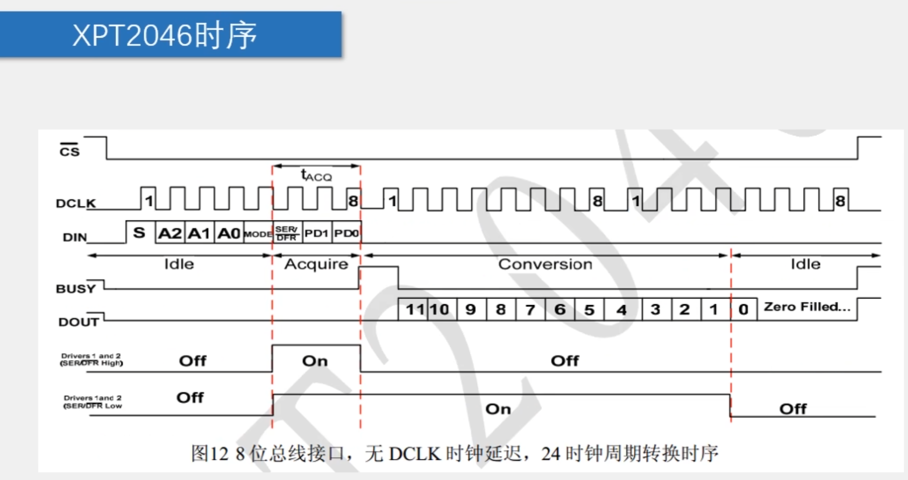
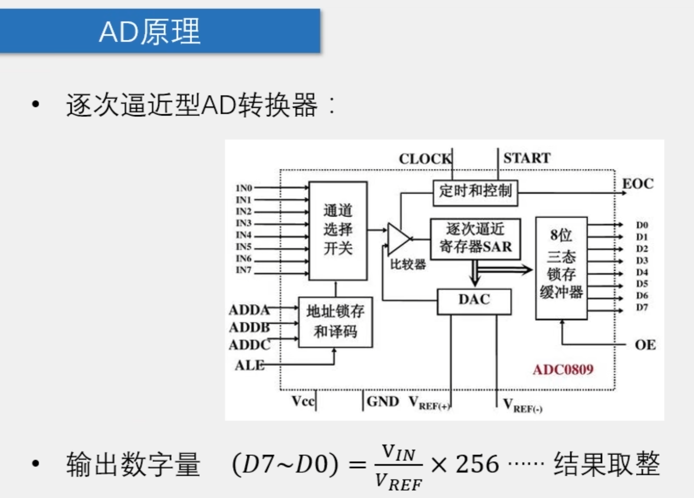

# day 15

今天的内容是AD/DA

## 16-1 AD模数转换

[源码跳转](code\day15\16-1\main.c)

AD就是把模拟信号转换为数字信号，其实就是把输入电压等分后做比较来获得数字信号，像图片这里就是256等分，我这里就不详细讲时序图了，结合代码很简单就能看懂

## 16-2 DA数模转换

[源码跳转](code\day15\16-2\main.c)

DA就是把数字信号转换为模拟信号，不过一般用得比较少，之前学习过了PWM，PWM在大多数情况下都可以替代DA，所以这里也不详细讲解了
